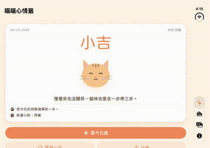

# 喵喵心情籤 Meow Fortune

> #01 使用 Xcode AI 創作人生第一個 App

每天一支專屬今日籤的貓咪抽籤 App：搖手機抽籤、SwiftData 紀錄、統計圖表、分享籤卡。



## 技術亮點
- **可重現的今日籤**：FNV-1a 64-bit 雜湊（名字 + 日期）當 SplitMix64 種子，同一天同一個人永遠抽到同一支；依等級權重加權抽籤。
- **SwiftData**：`@Model FortuneRecord` 儲存每次抽籤，`@Query` 即時更新列表，支援滑動刪除。
- **Swift Charts + 連續天數**：各等級次數長條圖；`Streak` 計算連續抽籤天數（今天還沒抽不會中斷）。
- **ImageRenderer + ShareLink**：把籤卡畫成圖片直接分享，畫面與分享圖共用同一個 view。
- **搖一搖**：攔截 UIWindow 的 motionEnded 轉成 SwiftUI 事件（模擬器 Device → Shake 也可以）。
- **音效**：用 Python 合成的三音鈴聲，AVAudioSession `.ambient` 不打斷使用者的音樂。
- **iOS 18 Tab API**：4 個分頁：抽籤、紀錄、貓咪圖庫（網路圖片）、關於。

## 架構

```mermaid
flowchart LR
  D[DrawView] --> E[FortuneEngine<br/>FNV-1a + SplitMix64]
  D -->|insert| SD[(SwiftData<br/>FortuneRecord)]
  H[HistoryView] -->|@Query| SD
  H --> ST[Streak]
  D --> IR[ImageRenderer] --> SL[ShareLink]
  G[GalleryView] --> NET[cataas.com AsyncImage]
```

邏輯層（Model / Engine）不依賴 SwiftUI，可以單獨測試；畫面只負責顯示與轉發事件。

## 作業需求對照

| 需求 | 實作 |
|---|---|
| 小遊戲或工具 | 抽籤工具 |
| 多個頁面 | 4 個分頁 + 照片詳細頁 |
| AI IDE 開發 | 見文章的 AI 對話紀錄 |
| App Icon 和名字 | 原創貓咪 icon、「喵喵心情籤」 |
| Assets 圖片 + 網路圖片 | 3 張原創插圖 + cataas.com |
| 客製字型 | jf open 粉圓 |
| 加分：音效 | chime.wav |

## 單元測試（Swift Testing）

`⌘U` 執行。涵蓋：FNV-1a 官方測試向量、今日籤同日穩定、名字大小寫、跨日變化、時區、加權機率（2 萬次抽樣）、資料完整性、連續天數 5 種情境、SwiftData 存讀。

## 環境與執行

- Xcode 26 以上（建議 Xcode 27）、iOS 18.0 以上
- 開啟 `MeowFortune.xcodeproj`，選 iPhone 模擬器按 ▶︎

## 開發

本專案在 AI（Claude）協助下開發，遵循 [SwiftUI Agent Skill](https://github.com/AvdLee/SwiftUI-Agent-Skill)（Antoine van der Lee）的檢查清單：`@State` 一律 private、`@Observable` 搭配 `@MainActor`、可點擊元素用 `Button`、iOS 18 Tab API、`sensoryFeedback`、支援 Reduce Motion 與 VoiceOver。

## 授權

- 字型：[jf open 粉圓](https://github.com/justfont/open-huninn-font)（SIL Open Font License 1.1，見 FONT_LICENSE）
- 插圖與 App Icon：本專案原創（Python 程式繪製）
